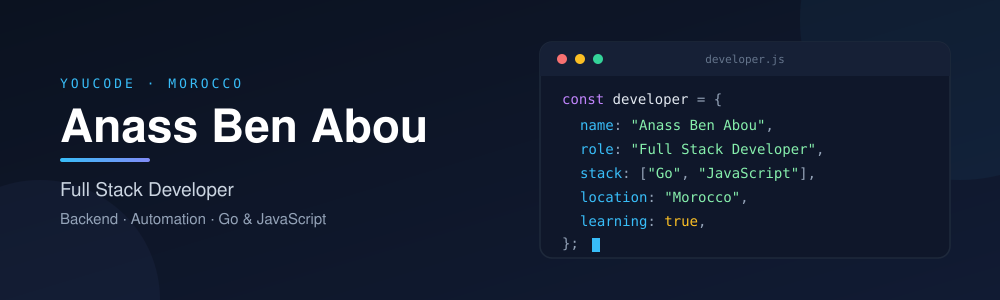

 

## Hi, I'm Anass 👋

I'm a **Full Stack Web Development student at YouCode, Morocco**. I enjoy building applications, exploring backend technologies, and turning ideas into useful digital products.

My approach is simple: **understand the problem, build a solution, and keep improving.**

 

### I make *pretty* things using:

 

- 🔭 I'm currently working on my goal to become a great **Full Stack / Backend developer**
- 🌱 I'm currently learning **Go, backend engineering & automation**
- 💬 Ask me about **JavaScript, Go, Linux and web development**
- 📫 How to reach me: [triat.code@gmail.com](mailto:triat.code@gmail.com)
- 😄 Pronouns: he/him
- ⚡ Fun fact: I love building things just to see how they work

---

## Featured Projects

<table>
<tr>
<td width="50%" valign="top">

### Nour Academy

**Education · Web Application**

A student enrollment platform for a tutoring and language academy in Nador.

`JavaScript` `HTML` `CSS`

[View Repository ↗](https://github.com/ben-anass/Nour-Academy)

</td>
<td width="50%" valign="top">

### DouzTach

**Backend · Go · Project Management**

A terminal-first project management application built around team collaboration and Scrum workflows.

`Go` `Backend` `CLI`

[View Repository ↗](https://github.com/ben-anass/DouzTach)

</td>
</tr>
<tr>
<td width="50%" valign="top">

### LinkPilot AI

**Artificial Intelligence · Automation**

An AI-powered project focused on automating LinkedIn content workflows.

`AI` `Automation`

[View Repository ↗](https://github.com/ben-anass/LinkPilot-AI)

</td>
<td width="50%" valign="top">

### Marchica Trips

**Tourism · UI · Accessibility**

A responsive and accessible redesign for a tourism platform in the Marchica region.

`Vite` `Tailwind CSS`

[View Repository ↗](https://github.com/ben-anass/marchica-trips)

</td>
</tr>
<tr>
<td width="50%" valign="top">

### Loup-Garou

**JavaScript · Multiplayer Game**

An online Werewolf game with public and private rooms and cross-platform gameplay.

`JavaScript`

[View Repository ↗](https://github.com/ben-anass/loup-garou)

</td>
<td width="50%" valign="top">

### Weather App

**JavaScript · API Integration**

A multi-city weather application with current conditions and forecasts.

`JavaScript` `Fetch API`

[Repository ↗](https://github.com/ben-anass/weather-app) · [Live Demo ↗](https://meteoyoucode.vercel.app/)

</td>
</tr>
</table>

### More from my GitHub

| Project | Description |
|:--|:--|
| [Windy App](https://github.com/ben-anass/Windy-App) | Weather dashboard with dynamic themes |
| [Nour Academy Back-office](https://github.com/ben-anass/Nour-Academy-Back-office) | Registration management |
| [Teacher Space](https://github.com/ben-anass/Nour-Academy-espace-enseignant) | Teacher interface |
| [Mafia Shadow Conflict](https://github.com/ben-anass/mafia-shadow-conflict) | JavaScript game project |
| [POOL-Z01](https://github.com/ben-anass/POOL-Z01) | Go programming |
| [Pool C](https://github.com/ben-anass/Pool_C) | C programming exercises |

---

## GitHub Stats

 

---

## Find me around the web 🌍

- 💼 Sharing updates on [LinkedIn](https://linkedin.com/in/anass-benabou-76b764393)
- 💻 Explore my work on [GitHub](https://github.com/ben-anass)

 

### Let's connect and create something meaningful.

Designed with curiosity. Built with consistency.

