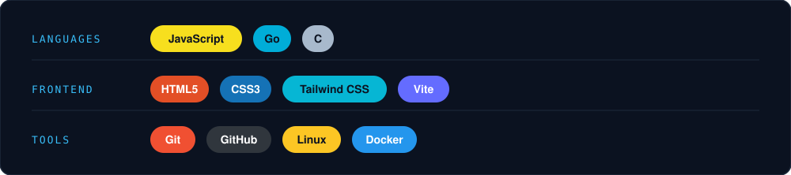

 

 

## About

Full Stack Web Development student at **YouCode, Morocco**. I build web applications, explore backend engineering, and turn ideas into useful digital products.

My approach is simple: **understand the problem, build a solution, keep improving.**

<table>
<tr>
<td width="50%" valign="top">

**Current focus**

- Full Stack Development
- Backend Engineering with Go
- Automation & Linux
- Shipping real projects

</td>
<td width="50%" valign="top">

**How I work**

- Clean, readable code
- Learn by building
- Collaborate and share
- Improve every day

</td>
</tr>
</table>

## Tech Stack

## Featured Projects

<table>
<tr>
<td width="50%" valign="top">

**[Nour Academy](https://github.com/ben-anass/Nour-Academy)**
 Student enrollment platform for a tutoring and language academy in Nador.
 `JavaScript` `HTML` `CSS`

</td>
<td width="50%" valign="top">

**[DouzTach](https://github.com/ben-anass/DouzTach)**
 Terminal-first project management app built around Scrum workflows.
 `Go` `Backend` `CLI`

</td>
</tr>
<tr>
<td width="50%" valign="top">

**[LinkPilot AI](https://github.com/ben-anass/LinkPilot-AI)**
 AI-powered automation of LinkedIn content workflows.
 `AI` `Automation`

</td>
<td width="50%" valign="top">

**[Marchica Trips](https://github.com/ben-anass/marchica-trips)**
 Responsive, accessible redesign of a tourism platform.
 `Vite` `Tailwind CSS`

</td>
</tr>
<tr>
<td width="50%" valign="top">

**[Loup-Garou](https://github.com/ben-anass/loup-garou)**
 Online Werewolf game with public and private rooms.
 `JavaScript`

</td>
<td width="50%" valign="top">

**[Weather App](https://github.com/ben-anass/weather-app)** · [Live demo](https://meteoyoucode.vercel.app/)
 Multi-city weather app with current conditions and forecasts.
 `JavaScript` `Fetch API`

</td>
</tr>
</table>

<b>More projects</b>

 

| Project | Description |
|:--|:--|
| [Windy App](https://github.com/ben-anass/Windy-App) | Weather dashboard with dynamic themes |
| [Nour Academy Back-office](https://github.com/ben-anass/Nour-Academy-Back-office) | Registration management |
| [Teacher Space](https://github.com/ben-anass/Nour-Academy-espace-enseignant) | Teacher interface |
| [Mafia Shadow Conflict](https://github.com/ben-anass/mafia-shadow-conflict) | JavaScript game project |
| [POOL-Z01](https://github.com/ben-anass/POOL-Z01) | Go programming |
| [Pool C](https://github.com/ben-anass/Pool_C) | C programming exercises |

## Activity

## Let's Connect

Open to collaborations, learning opportunities and interesting projects.

[GitHub](https://github.com/ben-anass) · [LinkedIn](https://linkedin.com/in/anass-benabou-76b764393) · [Email](mailto:triat.code@gmail.com)

Designed with curiosity. Built with consistency.

